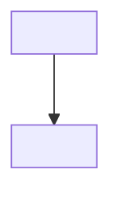
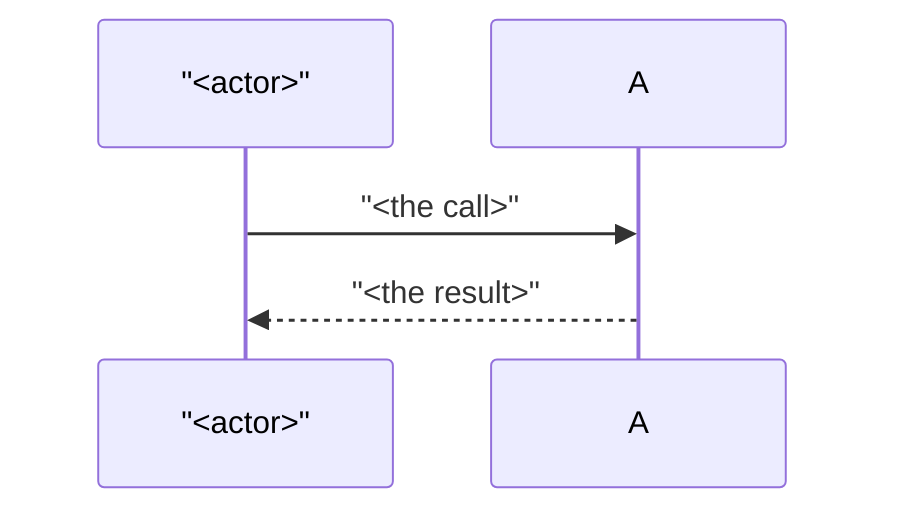
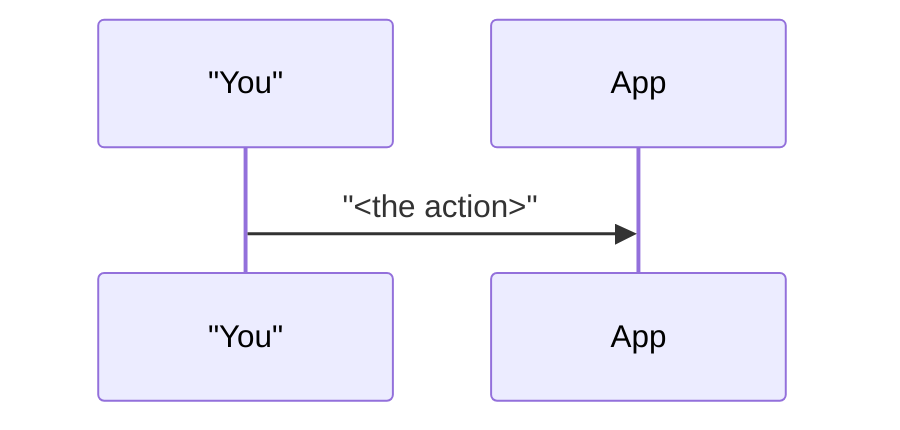

# Story artifact templates

Every artifact a case home can hold, in one file. Copy the section you need, drop the `---`
rulers, and replace **every** `<placeholder>` or delete the section it belongs to. Never leave a
`<placeholder>` in a real case home.

Budgets and section order are owned by the `story-context-home` skill; this file is the shape,
not the rules. Where a section is marked *(follow-up)*, it belongs only in a nested follow-up home.

---

## `STATE.json`

```json
{
  "case_id": "<YYYY-MM-DD_descriptive-short-name>",
  "project": "<PROJECT>",
  "parent": null,
  "workflow": "standard",
  "round": 1,
  "repo": "<absolute path to the project repo>",
  "branch": "<the working branch the user created>",
  "worktree": null,
  "current_step": "started",
  "next_command": "/story-2-plan",
  "test_baseline_commit_hash": null,
  "updated": "<YYYY-MM-DD>"
}
```

---

## `STATUS.md`

```markdown
# <YYYY-MM-DD_descriptive-short-name>

**Home:** `~/.claude/plans/<PROJECT>/<case-id>/`
**Repo:** `<absolute path>` · **Branch:** `<branch>`
**Parent:** `../` — <parent case ID>            <!-- follow-up only; delete otherwise -->

**Step:** <current_step> · **Next:** `<next_command>` · updated <YYYY-MM-DD>

**Building:** <one line of scope>

**Unanswered:** <the open questions still waiting on the user, or "none">
```

≤ 25 lines. Written by the main session only — never by an agent.

---

## `RESEARCH.md`

```markdown
# <case-id> — research

## Summary

<Three to six sentences: what this change has to fit into, stated so someone who has never opened
the repo can follow the plan that comes next. Prose, not bullets.>

## Files that matter

| Path | Why it matters |
|---|---|
| `<path>` | <what it does and what this change will have to do to it> |

## Patterns and contracts to follow

- **<name of the pattern>** — <how the codebase already does this, and where to see it>

## Risks

- **<risk>** — <what could go wrong, and what would make it visible early>

## Prior art

<What the LLM Wiki already records about this area, or "nothing recorded" — never invent an entry.>

## Open Questions

- **Q:** <what research could not settle>
  **A:**
```

≤ 70 lines (≤ 40 on a follow-up, where it holds only the delta and the wrap deletes it).

---

## `PLAN.md`

```markdown
# <case-id>

## Context

<Two to five lines: what the user wants, why now, and what in the current code makes this
non-trivial. Prose, not bullets. No code.>

**Repo:** `<absolute path>` · **Branch:** `<branch>`

## Scope

**Building:**
- <observable change 1>

**Not building:**
- <the adjacent thing this case deliberately leaves alone, and why in half a line>

## Phases

Each phase is independently validatable. 2–4 of them.

1. **<Phase name>** — <what changes>. *Validation:* <what proves it works>. *Satisfies:* AC1, AC2
2. **<Phase name>** — <what changes>. *Validation:* <what proves it works>. *Satisfies:* AC3

## Acceptance criteria

Observable behaviors, phrased so a test can encode each one directly. Canonical and numbered —
everything else in the system cites the number rather than restating the criterion.

- **AC1** — <given X, when Y, then Z>
- **AC2** — <given X, when Y, then Z>
- **AC3** — <given X, when Y, then Z>

## Commands

Established during intake, run verbatim by `/story-3-tdd-red` and the agents.

| Purpose | Command | Run from |
|---|---|---|
| Test (whole suite) | `<command>` | `<path>` |
| Test (this case's files) | `<command>` | `<path>` |
| Build | `<command>` | `<path>` |

*Optional, added at Gate 2 only if the user accepts the layer run order the red step proposes —
one row per implementation layer, **lowest layer first**. The builder and checker run these in
order before the whole-suite command and report the first failing layer. Delete this note if the
case has none.*

| Test (layer: `<lowest layer>`) | `<command>` | `<path>` |
| Test (layer: `<next layer>`) | `<command>` | `<path>` |

## For the builder

This section is the builder's prompt. 5–10 lines.

- **Read:** <the artifacts and the few source files it should start from>
- **Constraints:** <what it must not change; conventions it must match>
- **Done when:** `<the validation command that decides it>` passes and every AC is demonstrable.

## Follow-ups

<!-- appended by /story-followup-1-start; delete the section until one exists -->

| Case | What it covers | Status |
|---|---|---|
| `<followup-case-id>` | <one line> | open / wrapped |

## Divergence Log

<!-- appended by /story-5-check -->

- **<what changed>** — planned <X>, built <Y>.
  *Why:* <the reason, as far as the code shows it>.
  *Matters:* <yes, and what it costs / no, and why not>.

## Open Questions

Answered inline by the user. Never edited by any command — only appended to. Exempt from the
line budget.

- **Q:** <question raised at a gate>
  **A:**
```

≤ 80 lines excluding the Divergence Log and Open Questions.

### `## Build close-out` *(follow-up)*

A follow-up has no `IMPLEMENTATION.md`; the build's close-out is a section in its `PLAN.md`,
≤ 6 lines, in the shape of `IMPLEMENTATION.md`'s verdict block below.

### `## Test changes` *(follow-up)*

A follow-up's plan enumerates the test edits its red step will make, because it usually updates
existing test files rather than adding new ones:

```markdown
## Test changes

- `<test file>` — <which AC, and what the edit asserts>
```

---

## `ARCHITECTURE.md`

```markdown
# <case-id> — architecture

**Status:** PLANNED · updated <YYYY-MM-DD>

## Concepts in this story

Every term the diagrams use that a newcomer to this codebase would not know.

- **<term>** — <one line, in plain English>

## The model in plain English

<Three to six sentences naming the pieces and what causes what. Written first: if you cannot
write this, the diagrams will not save the reader.>

## Components



## Sequence



## State

<!-- Optional. Delete the whole section unless something genuinely has states and transitions.
     Three diagrams is the hard cap, so this one costs you any other. -->

## Why not the obvious thing

<The approach a competent reader would expect, and the specific reason this case does something
else. At most two rejected alternatives, one short paragraph each. If nothing obvious was
rejected, say so in one line — never invent a strawman.>

## Read the code in this order

1. `<path>` — <what to look for>
2. `<path>` — <what to look for>
```

≤ 3 diagrams. Refreshed **in place** by `/story-5-check`; never a second as-built copy.

---

## `MANUAL_TESTING.md`

```markdown
# <case-id> — manual testing

One procedure per acceptance criterion, ≤ 5 steps each. Written from the user's seat: what to
click, type, or run, and what you should see. No code, no test-runner commands.

## AC1 — <the criterion, restated in half a line>

1. <step>
2. <step>

**Expect:** <what proves AC1 is met>

## AC2 — <…>

1. <step>

**Expect:** <…>

## Special cases

<!-- appended by the build and reconciled by /story-5-check -->

- **<what the build turned up>** — <how to exercise it and what should happen>

## Follow-ups

<!-- appended by /story-followup-5-check, one block per follow-up case -->

### <followup-case-id> — <one line>

1. <step>

**Expect:** <…>
```

≤ 50 lines.

---

## `IMPLEMENTATION.md`

```markdown
# <case-id> — implementation

test ✓ <N>/<N> · build ✓

Phase 1 — <one line: what landed>
Phase 2 — <one line: what landed>

**Test changes:** <none — or exactly which test files changed and why>
**Deviation:** <only if the build departed from the plan: what and why>
```

≤ 40 lines. The **verdict, not the transcript** — paste raw output only for a failure, and only
the failing part.

---

## `REVIEW.md`

```markdown
# <case-id> — review

Run <YYYY-MM-DD> · <which reviews were dispatched> · verdict: APPROVED | NEEDS_FIX

| # | Severity | Finding | Where | Ruling |
|---|---|---|---|---|
| 1 | <high/med/low> | <one line> | `<path>` | fix now / follow-up `<case-id>` / accepted |
```

Uncapped — it grows with findings, not with prose.

---

## `MODEL.md` *(transient)*

```markdown
# <case-id> — user-flow model

**Transient.** Drawn on demand by `/story-model`; deleted by the wrap. A learning aid, never a
contract.

## <flow name>


```
