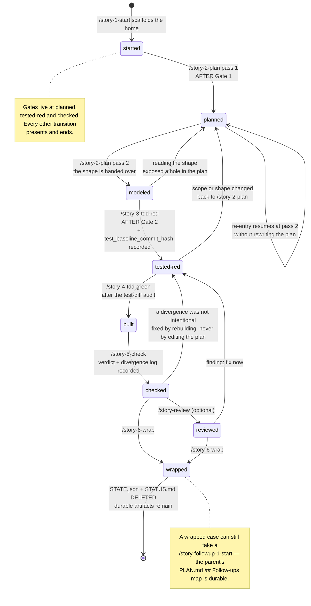

# `/story-*` workflow — flowchart

Mermaid diagrams of the command workflow described in this repo (`README.md`, `commands/`,
`skills/`, `agents/`).

**This file is the system's rendered-diagram mirror — the one place the diagrams live.**
`/story-explain-workflow` carries the prose reference and two ASCII sketches but deliberately **no
Mermaid of its own**, so there is never a second rendering of a flow to contradict this one.
`/story-update-workflow` reconciles every view below in the same gated commit that changes the
system; a view that no longer matches the commands is a bug, not a stale copy.

Four views:

1. [Standard flow](#1-standard-flow) — a top-level case, `/story-1-start` → `/story-6-wrap`
2. [Follow-up flow](#2-follow-up-flow) — a subtask, `/story-followup-1-start` → `-6-wrap`
3. [How the two flows connect](#3-how-the-two-flows-connect) — plus the off-flow commands
4. [Case state machine](#4-case-state-machine) — `STATE.json.current_step` transitions

**Legend (used in every diagram):**

| Shape / style | Meaning |
|---------------|---------|
| Rounded, thick border | A command you type |
| Diamond | **Gate** — control stops and waits for you |
| Parallelogram | Work done in an isolated **agent** |
| Rectangle | Work done in your **main session** |
| Dashed box | Artifacts written / deleted |
| `▮` | A **local commit** (nothing in this workflow ever pushes) |

---

## 1. Standard flow

Two gates before any product code — the **plan** and the **test contract** — and one after it,
the **divergences**. Everything else presents an artifact and ends.

```mermaid
flowchart TD
    START(["You type: /story-1-start [description]"]):::cmd

    START --> SC["Main session runs intake, then scaffolds<br/>~/.claude/plans/PROJECT/DATE_name/<br/>STATE.json + STATUS.md + PLAN.md context and commands<br/>(an existing case ID stops the command, never overwritten)"]:::sess
    SC --> RS[/"agent: story-researcher<br/>sweeps the codebase from the intake brief,<br/>reads the LLM Wiki for prior art (never writes it),<br/>says what is there — never what to build"/]:::agent
    RS -. writes .-> DR[["RESEARCH.md &le;70 lines<br/>+ STATUS-story-researcher.md"]]:::docs
    RS --> RB["Main session reads RESEARCH.md back and summarizes it"]:::sess
    RB --> RG{"READ GATE<br/>read RESEARCH.md,<br/>answer Open Questions"}:::gate
    RB -. writes .-> DS1[["STATUS.md + STATE.json"]]:::docs

    RG --> P0(["You type: /story-2-plan"]):::cmd
    P0 --> PA[/"agent: story-planner — 'plan' mode<br/>scope, 2-4 phases, numbered AC1..ACn,<br/>and For the builder — which IS the builder's prompt"/]:::agent
    PA -. writes .-> DP[["PLAN.md &le;80 lines"]]:::docs
    PA --> G1{"GATE 1<br/>answer open questions<br/>and APPROVE the plan"}:::gate
    G1 -- "not approved" --> PA
    G1 -- approved --> PB[/"agent: story-planner — 'model' mode<br/>story-architecture-diagram skill: components + sequence,<br/>plus one 5-step manual procedure per criterion"/]:::agent
    PB -. writes .-> DAM[["ARCHITECTURE.md &le;3 diagrams<br/>MANUAL_TESTING.md &le;50 lines"]]:::docs
    PB --> PH["Main session renders both diagrams inline<br/>and hands the shape over to read"]:::sess
    PH -- "the shape exposes a hole in the plan" --> PA
    PH -. updates .-> DS2[["STATUS.md + STATE.json"]]:::docs

    PH --> T0(["You type: /story-3-tdd-red"]):::cmd
    T0 --> TA["Main session, story-tdd skill, RED phase only, five stages:<br/>1 DESIGN — functional-test-design: initial states, terminal states,<br/>the paths between, each kept path mapped to an AC<br/>2 WRITE — path tests per criterion, every assertion commented<br/>3 DIAGNOSE — test-suite-analysis--diagnostic-capability:<br/>layer map, failures that localize, lowest-first run order<br/>4 FACTOR — test-suite-analysis--test-tasks: common procedures<br/>into task-library helpers, this pass's tests only<br/>5 RUN — confirm they fail for the RIGHT reason.<br/>Amends PLAN.md with what the stages turned up"]:::sess
    TA --> TQ{"did that change<br/>SCOPE or SHAPE?"}:::gate
    TQ -- yes --> P0
    TQ -- no --> G2{"GATE 2<br/>read and APPROVE the tests, path inventory,<br/>layer map, task list + any plan amendment.<br/>An accepted run order becomes<br/>Test (layer) rows in ## Commands"}:::gate
    G2 -- "amend the tests, paths, layers or tasks" --> TA
    G2 -- approved --> TC["Main session commits tests + helpers + PLAN.md &#9646;<br/>with the path inventory in the commit body,<br/>and records STATE.json.test_baseline_commit_hash —<br/>this is the contract the build is measured against"]:::sess

    TC --> B0(["You type: /story-4-tdd-green"]):::cmd
    B0 --> BA[/"agent: story-builder — prompted with almost nothing:<br/>PLAN.md's For the builder + ARCHITECTURE.md.<br/>Implements every phase to green, runs the REAL test<br/>and build commands, commits locally &#9646;"/]:::agent
    BA -. "logs as it works" .-> DSB[["STATUS-story-builder.md"]]:::docs
    BA -. writes .-> DI[["IMPLEMENTATION.md &le;40 lines — the verdict,<br/>including a Test changes: line, always"]]:::docs
    BA -. appends .-> DM[["MANUAL_TESTING.md — special cases the build turned up"]]:::docs
    BA --> BD["Main session diffs the test files<br/>HEAD vs test_baseline_commit_hash.<br/>Anything the builder did not explain is surfaced<br/>to YOU as a finding — never reverted"]:::sess
    BD -. updates .-> DS3[["STATUS.md + STATE.json"]]:::docs

    BD --> C0(["You type: /story-5-check"]):::cmd
    C0 --> CA[/"agent: story-checker — reads the CODE first, the plan second.<br/>Runs the verification suite in the background while it<br/>refreshes ARCHITECTURE.md in place, reconciles<br/>MANUAL_TESTING.md, and logs every divergence. Commits docs &#9646;"/]:::agent
    CA -. "logs as it works" .-> DSC[["STATUS-story-checker.md"]]:::docs
    CA -. writes .-> DD[["ARCHITECTURE.md refreshed in place<br/>PLAN.md ## Divergence Log, &le;3 lines each"]]:::docs
    CA --> CR["Main session records the verification verdict<br/>and relays the divergence log in full"]:::sess
    CR -. updates .-> DS4[["STATUS.md + STATE.json"]]:::docs
    CR --> G3{"GATE 3<br/>rule on each divergence,<br/>then test by hand from MANUAL_TESTING.md"}:::gate
    G3 -. "anything it turns up" .-> FOLLOWUP(["make a worktree, then<br/>/story-followup-1-start"]):::cmd
    G3 -- "not intentional" --> T0

    G3 --> RV0(["OPTIONAL: /story-review"]):::opt
    RV0 --> RVA["Main session dispatches the built-in /code-review<br/>and /security-review over the branch diff"]:::sess
    RVA -. writes .-> DRV[["REVIEW.md — a findings table, uncapped"]]:::docs
    RVA --> RVT{"triage each finding:<br/>fix now, defer, or accept"}:::gate
    RVT -- "fix now" --> T0
    RVT -- defer --> FOLLOWUP

    G3 --> W0(["You type: /story-6-wrap"]):::cmd
    RVT -- "no blockers" --> W0
    W0 --> WA["Main session, story-wrap skill: writes the LLM Wiki entry<br/>describing what SHIPPED, then deletes the transients"]:::sess
    WA -. deletes .-> D5[["STATE.json, STATUS.md,<br/>every STATUS-agent.md, MODEL.md"]]:::docs
    WA --> WB["Close-out commit &#9646; — never a merge, never a push"]:::sess
    WB --> DONE(["Case wrapped. The durable artifacts remain;<br/>the branch is yours to merge or open a PR from"]):::done

    classDef cmd fill:#1f3a5f,stroke:#4a90d9,stroke-width:3px,color:#fff
    classDef opt fill:#2b2b3d,stroke:#7a7a9a,stroke-width:2px,stroke-dasharray:5 3,color:#fff
    classDef gate fill:#5f1f2b,stroke:#d94a5a,stroke-width:3px,color:#fff
    classDef agent fill:#1f4f3a,stroke:#3fa87a,stroke-width:2px,color:#fff
    classDef sess fill:#2f2f3a,stroke:#9a9ab0,stroke-width:2px,color:#fff
    classDef docs fill:#4a3f1f,stroke:#c9a227,stroke-width:1px,stroke-dasharray:4 3,color:#fff
    classDef done fill:#1f4f1f,stroke:#4ad94a,stroke-width:3px,color:#fff
```

---

## 2. Follow-up flow

The compressed subtask path. It drops the diagramming pass — **never** the separation of tests
from code — so it keeps the same **two gates**. Steps 3, 4 and 5 are thin wrappers around the
standard flow's commands.

```mermaid
flowchart TD
    PRE["YOU FIRST — no command does this:<br/>git worktree add -b SUB PATH PARENT-BRANCH<br/>then cd into it"]:::human
    PRE --> F0(["/story-followup-1-start PARENT-ID [description]<br/>the parent is named, never inferred"]):::cmd

    F0 --> FR["Main session RECORDS the checkout and branch it<br/>finds itself in; resolves the parent case —<br/>in progress OR already wrapped;<br/>scaffolds the home NESTED inside the parent's"]:::sess
    FR -. "registers a row on" .-> PARENT[["parent's PLAN.md ## Follow-ups table<br/>(durable — survives the parent's wrap)"]]:::docs
    FR --> FRS[/"agent: story-researcher in DELTA mode —<br/>reads the parent's artifacts first,<br/>researches only what is new"/]:::agent
    FRS -. writes .-> FDR[["RESEARCH.md &le;40 lines — TRANSIENT here"]]:::docs

    FRS --> FP0(["/story-followup-2-plan"]):::cmd
    FP0 --> FPA[/"agent: story-planner 'plan' mode — plus a<br/>self-contained 'Builds on parent' section and a<br/>## Test changes list. Scope, 1-3 phases, numbered ACs.<br/>PLAN.md &le;60 lines covers EVERYTHING"/]:::agent
    FPA --> FPP["Main session presents the PARENT's sequence diagram<br/>and names which arrows this follow-up changes —<br/>a follow-up draws none of its own"]:::sess
    FPP --> FG1{"GATE 1 of 2<br/>read it against the parent's<br/>diagrams, then APPROVE"}:::gate
    FG1 -- "amend in place" --> FPA

    FG1 -- approved --> FT0(["/story-followup-3-tdd-red<br/>thin wrapper over /story-3-tdd-red"]):::cmd
    FT0 --> FTA["Author the tests ## Test changes enumerates —<br/>usually edits to EXISTING files. Same five stages,<br/>scoped to the delta: design only the changed paths,<br/>diagnose and factor only the tests touched.<br/>Run them, confirm they fail correctly"]:::sess
    FTA --> FG2{"GATE 2 of 2<br/>read and APPROVE the tests<br/>+ any plan amendment"}:::gate
    FG2 -- "re-plan needed" --> FP0
    FG2 -- approved --> FTC["Commit tests + helpers + PLAN.md &#9646; on the follow-up branch,<br/>path inventory in the body, trailer 'Case: PARENT &gt; SUB';<br/>record test_baseline_commit_hash"]:::sess

    FTC --> FB0(["/story-followup-4-tdd-green<br/>thin wrapper over /story-4-tdd-green"]):::cmd
    FB0 --> FBA[/"agent: story-builder, workflow=followup.<br/>Same contract, same audit — followup changes only<br/>WHERE it runs and where it records. Commits &#9646;"/]:::agent
    FBA -. writes .-> FD1[["## Build close-out in PLAN.md, &le;6 lines —<br/>NO IMPLEMENTATION.md. Special cases go to<br/>the PARENT's MANUAL_TESTING.md"]]:::docs
    FBA --> FBD["Main session diffs the tests against the baseline —<br/>exactly as on the standard path"]:::sess

    FBD --> FC0(["/story-followup-5-check<br/>thin wrapper over /story-5-check"]):::cmd
    FC0 --> FCA[/"agent: story-checker on the PARENT's artifacts:<br/>refreshes ../ARCHITECTURE.md in place, reconciles the<br/>parent's ## Follow-ups procedure. The divergence log<br/>lands in the follow-up's own PLAN.md. Commits docs &#9646;"/]:::agent
    FCA --> FCR["Main session records the verdict and relays"]:::sess
    FCR --> FHAND{"GATE 3<br/>review the divergence log, then work<br/>through the parent's procedure by hand"}:::gate

    FHAND -.-> FRV0(["optional: /story-review — shared as-is"]):::opt
    FRV0 -.-> FW0
    FHAND --> FW0(["/story-followup-6-wrap"]):::cmd

    FW0 --> FWA["PART A, in the worktree: wiki entry, flip the parent's<br/>## Follow-ups row, delete the transients — the pair, the<br/>agent logs, MODEL.md, AND RESEARCH.md. Commit &#9646;"]:::sess
    FWA --> FWQ{"is the parent branch<br/>main / master / develop?"}:::gate
    FWQ -- yes --> FSTOP(["REFUSES to merge — tells you to open a<br/>PULL REQUEST. Integrating a shared branch is a<br/>reviewed, remote operation. Part A still stands"]):::stop
    FWQ -- no --> FWM["PART B, from the parent's checkout:<br/>git merge --no-ff onto the parent story branch.<br/>Conflicts: keep ALL ## Follow-ups rows;<br/>STOP on any code conflict for you to resolve"]:::sess
    FWM --> FDONE(["Follow-up wrapped. PLAN.md is its ONLY durable<br/>artifact. Worktree and branch left in place<br/>for you to remove. Never pushed"]):::done

    FDONE -. "re-run /story-followup-1-start in the same checkout<br/>= another ROUND, bumps STATE.json.round" .-> F0

    classDef cmd fill:#1f3a5f,stroke:#4a90d9,stroke-width:3px,color:#fff
    classDef opt fill:#2b2b3d,stroke:#7a7a9a,stroke-width:2px,stroke-dasharray:5 3,color:#fff
    classDef gate fill:#5f1f2b,stroke:#d94a5a,stroke-width:3px,color:#fff
    classDef agent fill:#1f4f3a,stroke:#3fa87a,stroke-width:2px,color:#fff
    classDef sess fill:#2f2f3a,stroke:#9a9ab0,stroke-width:2px,color:#fff
    classDef docs fill:#4a3f1f,stroke:#c9a227,stroke-width:1px,stroke-dasharray:4 3,color:#fff
    classDef human fill:#4a2f5f,stroke:#a86fd9,stroke-width:2px,color:#fff
    classDef done fill:#1f4f1f,stroke:#4ad94a,stroke-width:3px,color:#fff
    classDef stop fill:#5f3a1f,stroke:#d98a4a,stroke-width:3px,color:#fff
```

---

## 3. How the two flows connect

The command-level view: both numbered sequences, the off-flow commands, and the arrows between
them. Gates marked `⟨Gate⟩`.

```mermaid
flowchart LR
    subgraph STD["Standard flow — a top-level case"]
        direction LR
        S1["/story-1-start<br/>story-researcher"]:::cmd
        S2["/story-2-plan<br/>⟨Gate⟩ approve plan,<br/>then read the shape"]:::gatecmd
        S3["/story-3-tdd-red<br/>⟨Gate⟩ approve tests<br/>commit &#9646; = baseline"]:::gatecmd
        S4["/story-4-tdd-green<br/>story-builder &#9646;<br/>+ test-diff audit"]:::cmd
        S5["/story-5-check<br/>story-checker &#9646;<br/>⟨Gate⟩ divergences"]:::gatecmd
        S6["/story-6-wrap<br/>wiki &#9646; drop transients"]:::cmd
        S1 --> S2 --> S3 --> S4 --> S5 --> S6
    end

    subgraph FUP["Follow-up flow — a subtask, in its own worktree"]
        direction LR
        F1["/story-followup-1-start<br/>PARENT named"]:::cmd
        F2["/story-followup-2-plan<br/>⟨Gate⟩ approve"]:::gatecmd
        F3["/story-followup-3-tdd-red<br/>⟨Gate⟩ approve · wrapper"]:::gatecmd
        F4["/story-followup-4-tdd-green<br/>wrapper"]:::cmd
        F5["/story-followup-5-check<br/>wrapper"]:::cmd
        F6["/story-followup-6-wrap<br/>&#9646; + merge"]:::cmd
        F1 --> F2 --> F3 --> F4 --> F5 --> F6
    end

    RV["/story-review<br/>optional · shared by both<br/>⟨Gate⟩ triage findings"]:::opt
    MD["/story-model<br/>optional, any time<br/>story-planner 'flows' mode<br/>MODEL.md — transient"]:::opt
    RS["/story-resume<br/>fresh-session entry point<br/>reads the handoff pair, advances nothing"]:::opt
    EX["/story-explain-workflow<br/>meta · read-only · prose + ASCII<br/>no diagrams — they live in this file"]:::meta
    UP["/story-update-workflow<br/>meta · changes the system itself<br/>⟨Gate⟩ approve the edit plan"]:::meta

    S5 -.-> RV -.-> S6
    F5 -.-> RV -.-> F6
    S5 -. "bug found by hand" .-> F1
    RV -. "defer a finding" .-> F1
    S6 -. "spin out a subtask against<br/>an already-wrapped parent" .-> F1
    F6 == "merge into the parent story branch<br/>NEVER into main — that would be a PR" ==> S6
    MD -. "draw the manual-testing flows" .-> S5
    RS -. "cd to STATE.json.worktree,<br/>then type next_command" .-> STD
    RS -.-> FUP
    UP -. "edits commands, skills, agents, then syncs<br/>the reference + README + THIS FILE<br/>in one gated local commit" .-> EX

    classDef cmd fill:#1f3a5f,stroke:#4a90d9,stroke-width:2px,color:#fff
    classDef gatecmd fill:#5f1f2b,stroke:#d94a5a,stroke-width:3px,color:#fff
    classDef opt fill:#2b2b3d,stroke:#7a7a9a,stroke-width:2px,stroke-dasharray:5 3,color:#fff
    classDef meta fill:#3a3a1f,stroke:#c9c94a,stroke-width:2px,stroke-dasharray:5 3,color:#fff
```

---

## 4. Case state machine

`STATE.json.current_step` — written **only** by the main session, never by an agent. An agent
*names* the step it reached in its summary; the session records it once that step's gate work is
done. The handoff pair (`STATUS.md` + `STATE.json`) is transient and the wrap deletes it, which is
why `/story-resume`'s `STATE.json` glob matches only **live** cases.

